<div align="center">

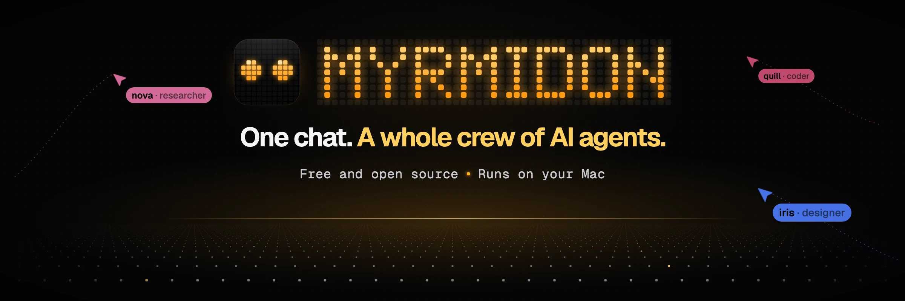

### You ask. A crew does it.

Myrmidon is a free, open-source AI agent platform for your Mac. Text it from your phone, talk to it, or type in the
app: it answers, writes code, drives a browser, uses your apps, and brings in a crew of specialists that plan,
build and check each other's work.

[](LICENSE)
[](#status)
[](https://bun.sh)
[](#status)

**[▶ Watch the film](docs/assets/myrmidon-film.mp4)** · **[Try it in two minutes](#try-it-in-two-minutes)** ·
**[★ Star it](https://github.com/Robinbinu/myrmidon)**

</div>

<a href="docs/assets/myrmidon-film.mp4">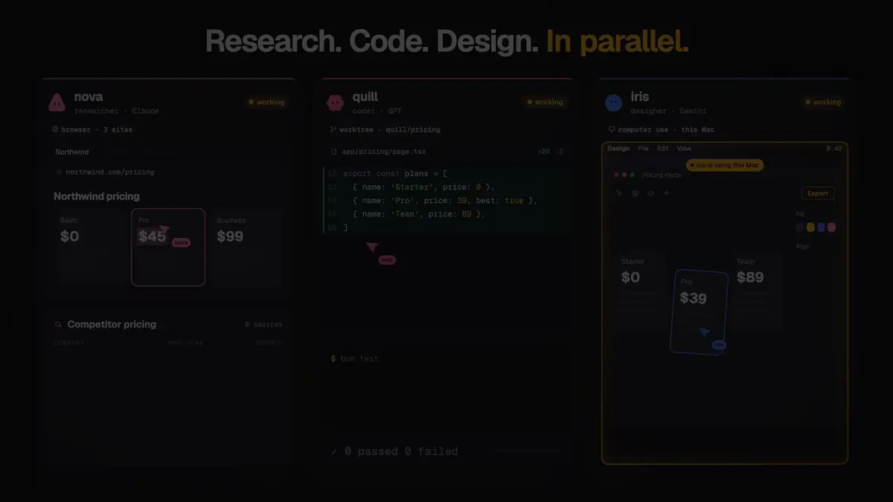</a>

---

## You use ten AI tools

A coding agent. A browser bot. A chatbot that forgets everything. A voice app, a scheduler, a model router, a bot in
every chat app. Each with its own login, its own memory and its own bill.

**Myrmidon is one chat that does all of it**, with one memory, one set of permissions and one record of everything
it did.

| Myrmidon does | The tools it can stand in for |
|---|---|
| Coding agent with checkpoints, a git worktree per worker, LSP, AST search and rewrite, a debugger and code cells | Claude Code, Codex CLI, Cline, Aider |
| Parallel agents on one repo, diffs per round, run comparison | Conductor, Codex app |
| Browser agent in a real Chrome, with login handoff and saved flows | Manus, Operator, Browser Use |
| Computer use on your Mac, with a glow and agent cursors while it works | Claude computer use, OpenAI CUA |
| Crews: lead and workers, or a leaderless swarm, with a reviewer and an advisor | CrewAI, AutoGen, LangGraph, Devin |
| 30 messaging channels: Telegram, WhatsApp, Signal, iMessage, Slack, Discord, Teams… | OpenClaw, Hermes Agent |
| Voice and phone calls that hand real work to the crew | ChatGPT Voice, Vapi |
| Every major model, by API key or by signing in with your subscription | OpenRouter, LiteLLM |
| Memory you approve, skills it learns, plugins in Claude Code's format | ChatGPT Memory, Claude Code plugins |


It is a harness, not a wrapper: Myrmidon runs its own agent loop, tools, sandbox and model calls. No other CLI has
to be installed or signed in.

## One evening with Myrmidon

### 11:12 PM · You text it like a teammate

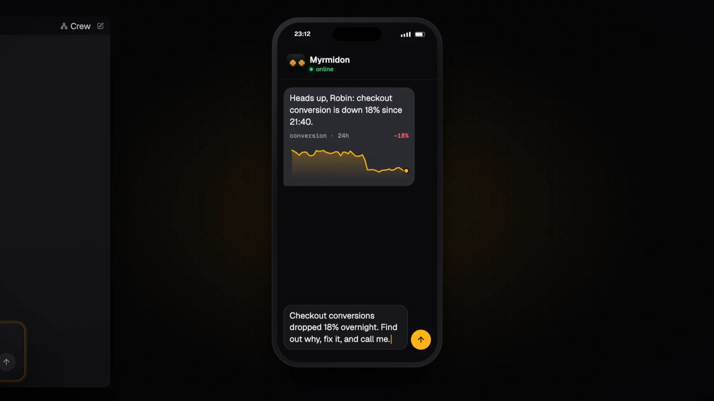

Checkout conversion just fell 18%. From Telegram, WhatsApp, iMessage or any of 30 apps, from the desktop app, or out
loud: *"Checkout conversions dropped 18% overnight. Find out why, fix it, and call me."*

### 11:13 PM · Your lead plans. A crew spawns.

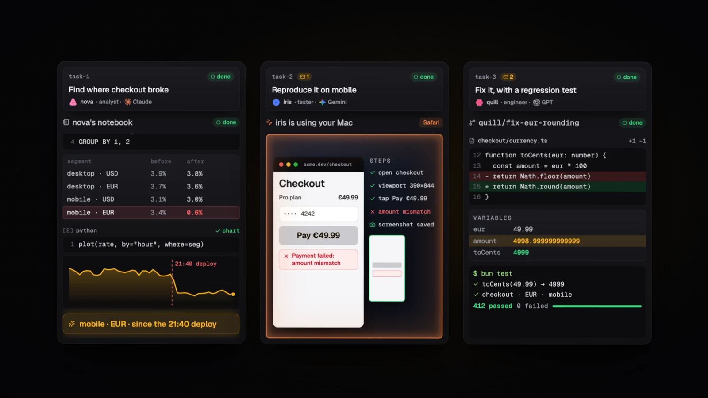

The lead splits the job and brings in specialists, each on the model it is best at. **nova** queries the analytics
in a notebook and finds the break: mobile, euros, since the 21:40 deploy. **iris** reproduces the failed payment on
your Mac itself, with an amber glow round the screen so you always know. **quill** stops on a breakpoint in its own
git worktree, finds a rounding bug, fixes it and writes the test that proves it.

### 11:40 PM · They check each other

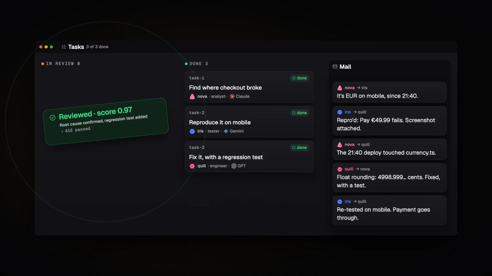

Crewmates message each other, hand work over and reject what isn't right. Nothing is done until an independent
reviewer runs the tests and confirms the root cause. Agents can't mark their own work as verified.

### 11:41 PM · You stay in charge

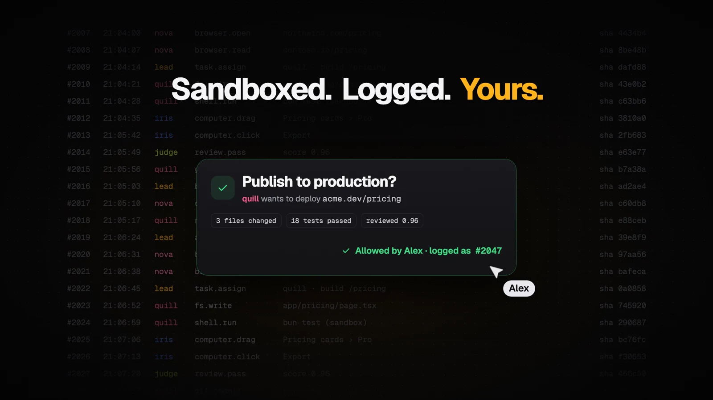

Everything runs in macOS's sandbox. Anything that matters waits for your yes, and every step is written to a log
that can't be edited or deleted. Rewind any change to your project.

### 11:45 PM · It calls you back

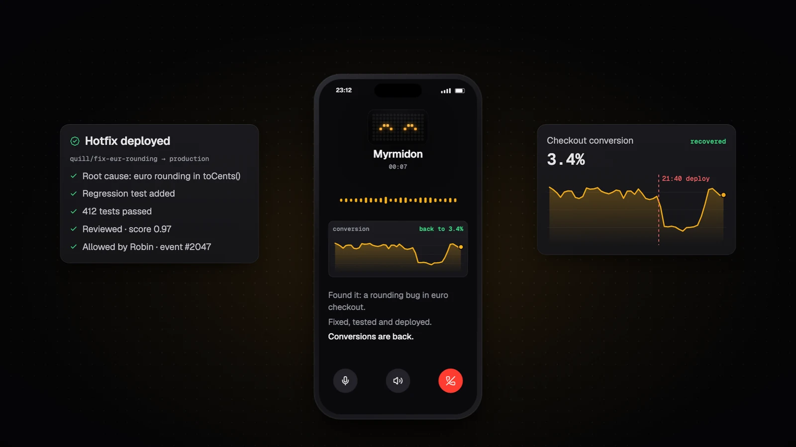

*"Found it: a rounding bug in euro checkout. Fixed, tested and deployed. Conversions are back."*

## And there's more

<table>
  <tr>
    <td width="50%">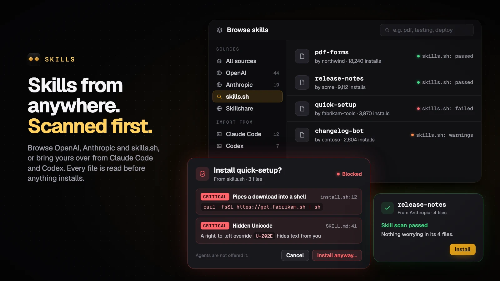</td>
    <td width="50%">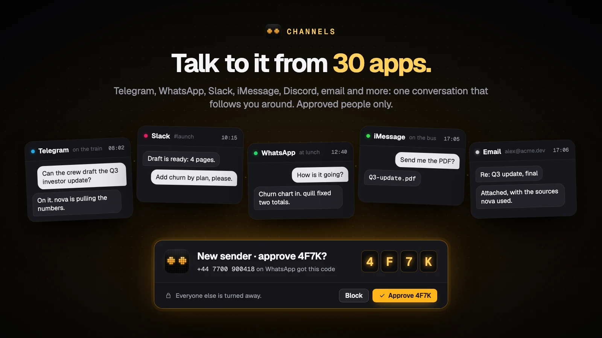</td>
  </tr>
  <tr>
    <td><b>Skills from anywhere, scanned first.</b> Browse OpenAI's and Anthropic's catalogs and skills.sh, bring
    over your Claude Code and Codex skills, and let the scanner hold anything dangerous.</td>
    <td><b>Talk to it from 30 apps.</b> Telegram, WhatsApp, Signal, iMessage, Slack, Discord, Teams, email, SMS and
    more continue the same chats. Only people you approve get in.</td>
  </tr>
  <tr>
    <td width="50%">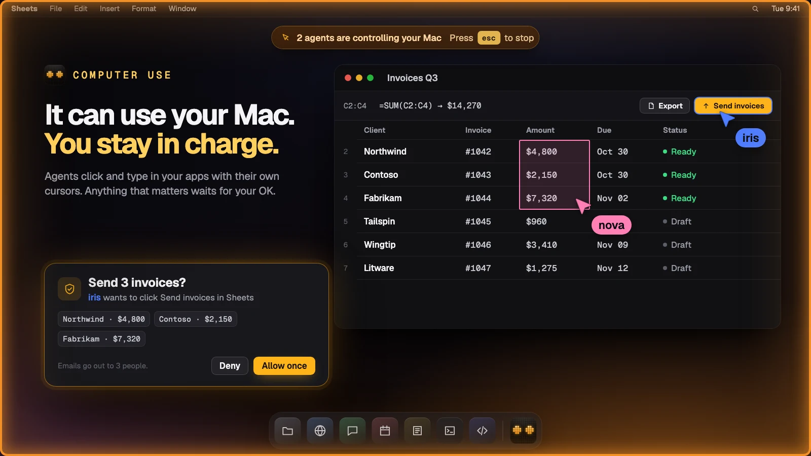</td>
    <td width="50%">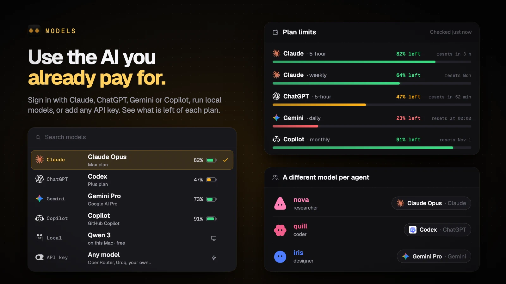</td>
  </tr>
  <tr>
    <td><b>It can use your Mac. You stay in charge.</b> One approved app at a time, consequential steps asked first,
    and Esc stops it.</td>
    <td><b>Use the AI you already pay for.</b> Sign in with Claude, ChatGPT, Gemini or Copilot, add any API key or a
    local model, and give each agent its own.</td>
  </tr>
  <tr>
    <td width="50%">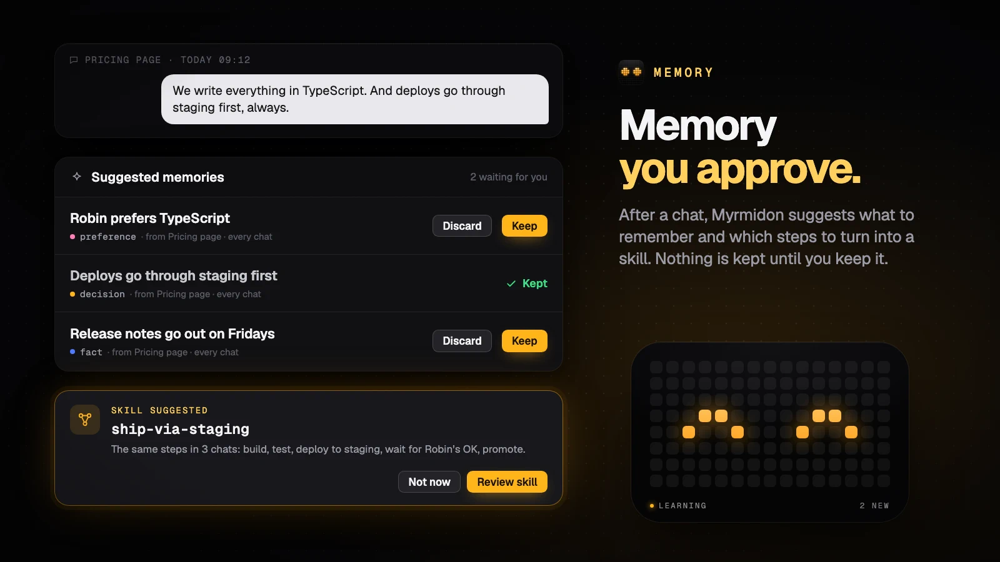</td>
    <td width="50%">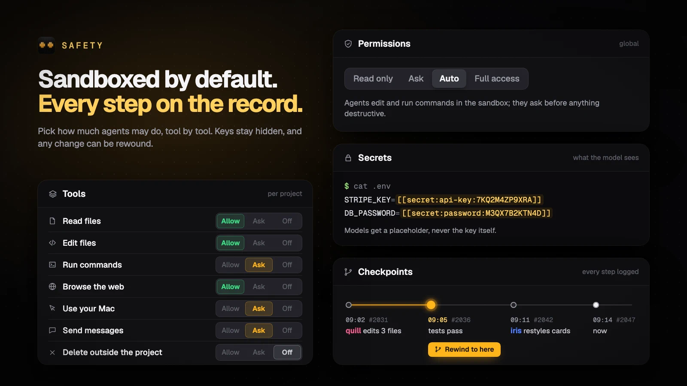</td>
  </tr>
  <tr>
    <td><b>Memory you approve.</b> It suggests what to remember and learns skills from finished work; you decide what
    is kept.</td>
    <td><b>Sandboxed by default.</b> Presets from Ask to Full access, a switch per tool, secrets that never reach a
    model, and every step on the record.</td>
  </tr>
</table>

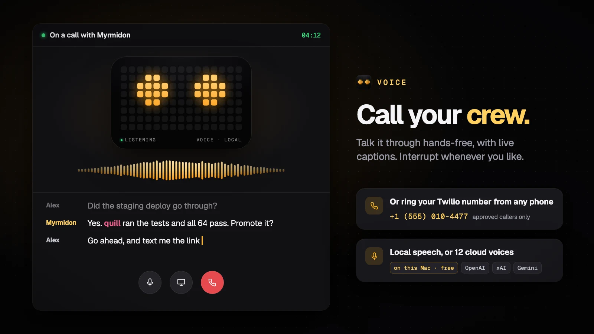

**Call your crew.** Press Call in the app or ring your own number from any phone. It talks while the crew works,
with speech on your Mac or from any of 12 cloud speech services.

## Try it in two minutes

**Download the app:** the [latest beta](https://github.com/Robinbinu/myrmidon/releases) has a macOS (Apple silicon)
disk image. It is signed but not yet notarized, so the first time macOS asks you to confirm: open it once, then
choose **Open Anyway** in System Settings → Privacy & Security.

**Or run it from source.** You need macOS, [Bun](https://bun.sh) 1.3.14 or newer, and one way to reach a model: sign in with Claude, ChatGPT,
Gemini or GitHub Copilot, or use an API key (`ANTHROPIC_API_KEY`, `OPENAI_API_KEY`, …).

```bash
git clone https://github.com/Robinbinu/myrmidon.git
```

```bash
cd myrmidon && bun install
```

```bash
bun run desktop
```

The desktop app starts its own server and opens a setup assistant: models, crew, a first project, voice, messaging
apps and alerts, every step skippable. It finds the providers you already have. Then type what you want done.

Prefer a browser tab? `bun run myr serve` prints a `http://127.0.0.1:…/#token=…` link. Prefer the terminal?
`bun run myr setup` signs you in and picks a model, and `bun run myr doctor` checks everything.

Coming from another tool? Bring your history and setup along:

```bash
bun run myr import-session   # Claude Code and Codex chats
```

```bash
bun run myr import-omp       # oh-my-pi keys, sign-ins and models.yml
```

## Under the hood

<details>
<summary><b>How it works</b></summary>


1. **The work sizes itself.** Every request goes to one lead with every tool. A question gets an answer, a script
   gets written by the lead alone, and a multi-part job escalates to a crew.
2. **Crews coordinate in the open:** a shared board with `@mentions`, direct messages, append-only notes, a task
   graph and versioned artifacts. Nothing is edited in place.
3. **Two crew modes.** *Orchestrated*: a lead plans and assigns specialists, each on its own model. *Swarm*: equal
   peers huddle, merge a plan and claim tasks.
4. **Done means checked.** An independent reviewer runs real tests, rules and a rubric; agents cannot mark their own
   work verified. An advisor watches the steps and steers when it sees a concrete problem.
5. **Nothing is hidden.** Every message, tool call, file and decision is an event in an append-only SQLite log that
   refuses `UPDATE` and `DELETE`. The UI, replay, audit view and exports all read it.

</details>

<details>
<summary><b>Everything it can do</b></summary>

### Code

- Works in your project folder and reads `AGENTS.md`, `CLAUDE.md` and `.myrmidon.md` at kickoff.
- File, `grep`, `glob` and `find` tools; `ast_grep` and `ast_edit` for structural search and rewrite; `lsp` for
  definitions, references and diagnostics; `debug` with any DAP adapter (debugpy, js-debug, lldb, gdb); `eval` code
  cells in JavaScript and Python whose state lasts the round.
- **Checkpoints and rewind** before a round's first write, diffs per round, and a Git view to stage and commit (it
  never pushes).
- **A git worktree per coding worker**, so parallel agents never share a working tree.
- Dev servers agents start and you watch live; an integrated terminal with several shells.
- A `github` tool for issues, pull requests, diffs, checks and Actions runs; writes always ask you first.
- `security_scan` for leaked secrets and vulnerable dependencies; `autoresearch` keeps a change only if a measured
  metric improves.
- `/goal` keeps going until a command, the checks or a judge says the goal holds.

### Browser and computer

- A real Chrome over CDP: snapshots, click, type, tabs, uploads, downloads, console, network, and
  `browser_extract(schema)` to turn a page into JSON.
- **Login handoff:** the agent asks, you sign in through the live view, it carries on. Agents never type passwords.
- Take over any time; saved browser flows replay as tools; your own tabbed browser beside the chat.
- **Computer use on macOS** through [Cua Driver](https://github.com/trycua/cua): one approved app at a time,
  consequential steps asked first, a glow round the screen and each agent's cursor while it works. Esc stops it.

### Crews

- Orchestrated and swarm modes, persistent workers across rounds, and specialists you keep for later chats.
- Mid-round escalation, task rejection with reasons, check-ins and `ask_user` pauses.
- A live task board, crew map, replay and run comparison with diffs.
- Review fitted to the work: tests for code, citations for research, a rubric for writing.
- Scripted crews in YAML for repeatable runs, with acceptance verifiers and budgets (see below).

### Models

- Anthropic, OpenAI, Codex, Gemini, OpenRouter, Ollama, xAI and any OpenAI-compatible endpoint, through
  [oh-my-pi](https://github.com/can1357/oh-my-pi).
- **Sign in with the subscriptions you already have**: Claude, ChatGPT, Gemini, GitHub Copilot and more. Plan limits
  show how much of each window is left, as a battery on the model chip.
- A different model per agent, fallback models when one fails, and compaction that respects each model's real
  context window.
- `generate_image` and `tts` for pictures and speech as chat artifacts.

### Channels, voice and devices

- **30 channels**: Telegram, WhatsApp (linked device or Cloud API), Signal, iMessage, Matrix, Slack, Discord,
  Mattermost, Microsoft Teams, Google Chat, LINE, WeChat, WeCom, Feishu/Lark, DingTalk, QQ, email, SMS, ntfy, IRC,
  Twitch, X, Nostr, SimpleX, Zalo, Synology Chat, Nextcloud Talk, Tlon and a generic webhook. They continue the same
  chats as the app.
- **Approved people only.** A new sender gets a code and nothing else until you approve them; members always run
  sandboxed and ask the owner before outside steps.
- **Voice and phone calls.** Press Call, or ring your Twilio number: a fast call model talks while the crew works.
  Speech runs locally (Phonon-2, Kitten TTS) or on Deepgram, ElevenLabs, Cartesia, OpenAI, Google, Azure, AWS and
  more, or the call runs on OpenAI Realtime or Gemini Live.
- **Run it on a server** and pair your devices over Tailscale or SSH. See [docs/remote.md](docs/remote.md).

### Extend it

- **MCP servers** over stdio, HTTP or SSE, with OAuth and a circuit breaker for flaky ones.
- **Plugins** in Claude Code's format, from Claude Code marketplaces, git or npm, reviewed before anything runs.
  Myrmidon plugins can add tools, prompts, chat cards, tabs and Settings pages. Ask the lead for a feature and it
  builds one as a plugin.
- **Skills** in the Agent Skills format, from your folders, `~/.claude/skills`, projects or a registry. Myrmidon
  learns new skills from finished rounds and retires the ones nobody uses.
- **A skill scanner** checks every skill before agents get it: prompt injection, data exfiltration, credential
  access, obfuscated code, pipe-to-shell installs, login persistence and hidden Unicode. A skill with a critical
  finding is held until you allow it.
- **Hooks** in Claude Code's format, **stream rules** that stop a reply mid-stream when it breaks a rule, and
  self-made tools kept in a library.
- **Memory** across chats: a cheap model suggests what to remember, you decide what is kept.

### Safe by default

- Commands run in macOS's sandbox: agents read the project and toolchains, write only the project and their work
  files, and cannot see the rest of your home, other chats or your keys.
- Secrets are redacted from logs and reach model providers as placeholders.
- Every tool can be Allow, Ask first or Off; projects start on ask; each run stops at $5 unless you raise it.
- An audit view of every file, URL and command each agent touched. Want it unrestricted? Turn on
  **full access** for a project; approvals still apply.

### The app

- A desktop app with native menus, notifications and a Dock badge, or any browser.
- ⌘K command menu, search across every chat, chat groups and forks, a file tree of your project.
- Export a chat as Markdown or a standalone HTML page, share it live with guests, or send an encrypted share file.
- Scheduled rounds, background runs (`myr ask --wait`) and OpenTelemetry export.

</details>

<details>
<summary><b>Scripted crews</b></summary>

Describe a crew in YAML and run it headless or with the UI:

```yaml
name: Calculator
mission: ./task.md            # inline text or a .md file
pattern: lead-workers         # or blackboard (swarm)
agents:
  - { name: lead, role: lead, model: anthropic/claude-sonnet-4-5 }
  - { name: coder, role: worker, model: openai/gpt-5, count: 2 }
acceptance:
  - { verifier: checks, rules: [{ artifact: index.html, contains: "<html" }] }
  - { verifier: command, run: "bun test", against: [src/, tests/] }
  - { verifier: llm-judge, model: openai/gpt-5, rubric: ./rubric.md, threshold: 0.8 }
budget: { wall: 15m, costUsd: 5, maxTurns: 40 }
observer: { interval: 30s }
```

```bash
bun run myr run examples/calculator/colony.yaml --ui
```

</details>

<details>
<summary><b>Command line</b></summary>

| Command | What it does |
|---|---|
| `myr serve [--port N] [--host ADDR] [--public-url URL]` | Start the server and web UI; a host or public URL makes it a remote gateway |
| `myr setup` · `myr doctor` | Set up in the terminal; check models, sandbox, browser, devices and channels |
| `myr login [ID]` · `myr key [PROVIDER]` · `myr model [REF]` | Sign in with a subscription, add an API key, or set the default model |
| `myr ask "<request>" [--wait]` | Send a request to a running server |
| `myr run <spec.yaml> [--ui]` | Run a scripted crew |
| `myr plugins …` · `myr skills …` | Search, add, update, remove and scan plugins and skills |
| `myr channels …` · `myr pair` | Set up messaging channels and pair devices |
| `myr import-session` · `myr import-omp` | Bring in Claude Code and Codex chats, or an oh-my-pi setup |
| `myr ls` · `myr events <id>` · `myr export <id>` | List crews and read or export their event logs |

Run them with `bun run myr …`. Data lives in `~/.myrmidon`; override with `--home DIR` or `MYRMIDON_HOME`.

</details>

<details>
<summary><b>Architecture</b></summary>

A Bun + TypeScript monorepo. The HTTP/WebSocket API and the event protocol are the contract, so new clients can
follow the app without the runtime changing.

| Package | Role |
|---|---|
| [`packages/protocol`](packages/protocol) | Event and payload types, crew state projection |
| [`packages/core`](packages/core) | Append-only event log, SQLite store, validation, redaction, guards, blobs |
| [`packages/runtime`](packages/runtime) | Agents, tools, crews, reviewer, sandbox, browser, computer use, MCP, skills, plugins, channels, voice |
| [`apps/web`](apps/web) | API server (local or remote gateway) and the React UI |
| [`apps/desktop`](apps/desktop) | The desktop app (Electrobun), running the server as a sidecar |
| [`apps/cli`](apps/cli) | The `myr` command |
| [`apps/eval`](apps/eval) | Eval harness with coding, browsing, research and crew cases |

</details>

## Status

Myrmidon is in **beta** and built for **macOS first**. It works end to end and is used every day, but APIs, the
event schema and storage formats will still change. Linux and Windows are next: the code is portable, and what is
left is tracked in [#27](https://github.com/Robinbinu/myrmidon/issues/27) (Linux) and
[#28](https://github.com/Robinbinu/myrmidon/issues/28) (Windows). See the [roadmap](ROADMAP.md).

## Join the crew

Myrmidon is big, and there is room for you in it:

- **Linux and Windows**: issues labeled [`linux`](https://github.com/Robinbinu/myrmidon/labels/linux) and
  [`windows`](https://github.com/Robinbinu/myrmidon/labels/windows).
- **Channels**: every channel is tested against fakes; trying one against the real service and fixing what breaks
  is a great first pull request.
- **Eval cases** in [`apps/eval`](apps/eval), and the agent docs in [`packages/runtime/docs`](packages/runtime/docs).

Before a pull request, read [CONTRIBUTING.md](CONTRIBUTING.md) and run `bun run check` (types, lint and the full
suite); keep changes focused and match the surrounding style. `bun run dev` serves the app with hot reload. Found a bug?
[Report it](https://github.com/Robinbinu/myrmidon/issues/new).

**If Myrmidon is useful to you, star it.** It's the simplest way to help more people find it.

## Acknowledgements

- [oh-my-pi](https://github.com/can1357/oh-my-pi)
- [Hermes Agent](https://github.com/NousResearch/hermes-agent)
- [OpenClaw](https://github.com/openclaw/openclaw)
- [Pipecat](https://github.com/pipecat-ai/pipecat)
- [LiveKit Agents](https://github.com/livekit/agents)
- [QwenPaw](https://github.com/agentscope-ai/QwenPaw)
- [Cisco AI Defense skill-scanner](https://github.com/cisco-ai-defense/skill-scanner)

Their license texts are in [THIRD_PARTY_NOTICES.md](THIRD_PARTY_NOTICES.md).

## Author

Myrmidon is created and maintained by [@Robinbinu](https://github.com/Robinbinu). Building
something with it, want to collaborate, or hiring for agent work? Say hello on
[LinkedIn](https://www.linkedin.com/in/michaelrobink).

## License

[Apache License 2.0](LICENSE). See [NOTICE](NOTICE) for attribution.
