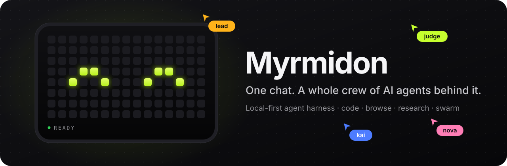
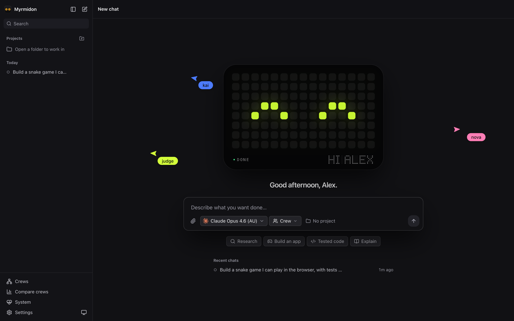
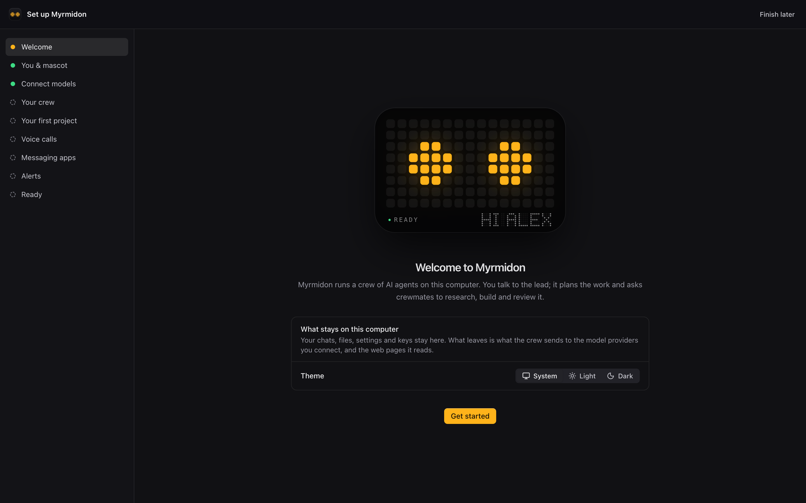
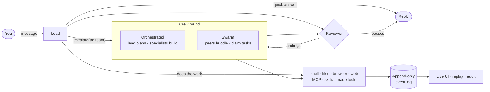
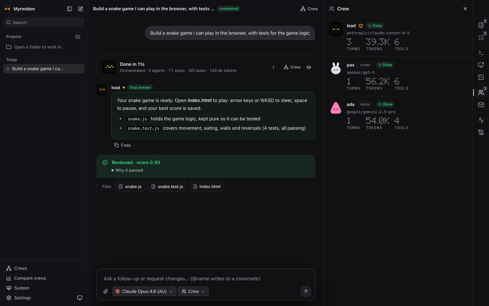
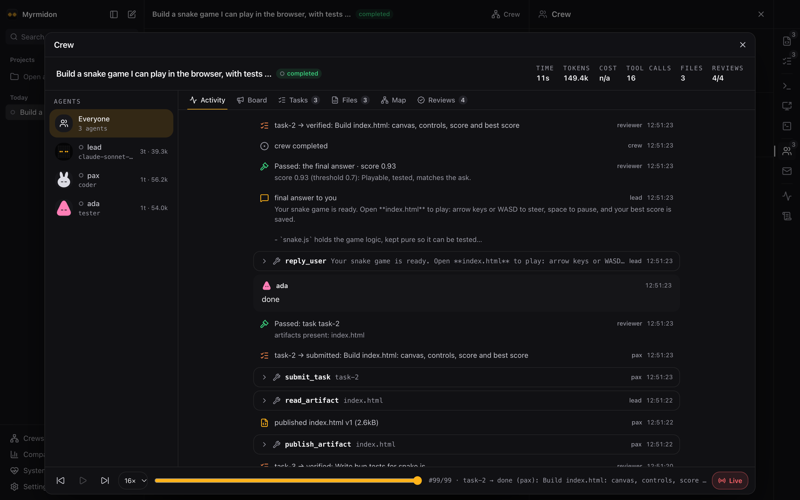
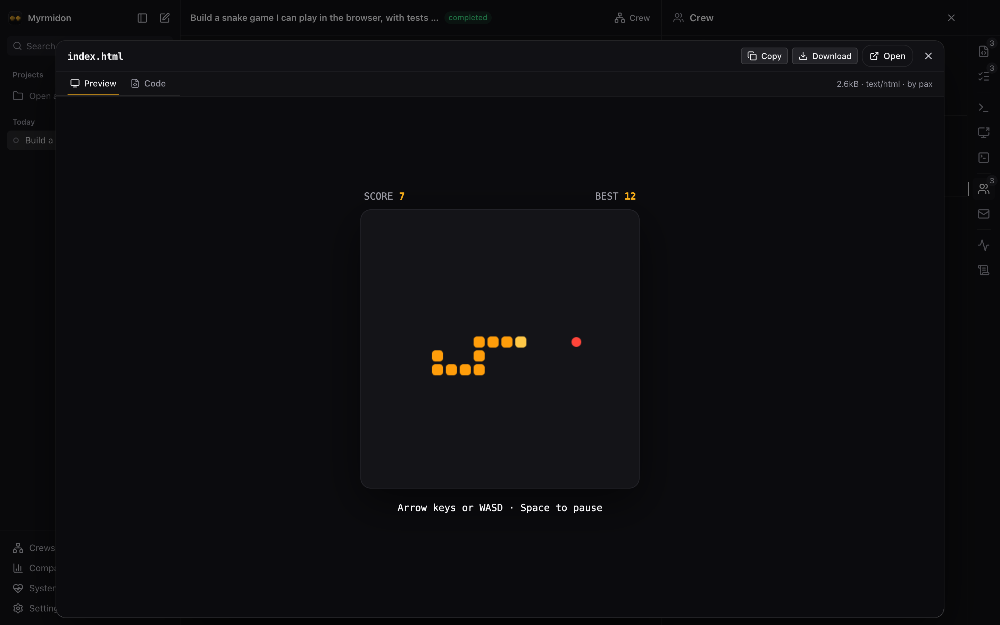
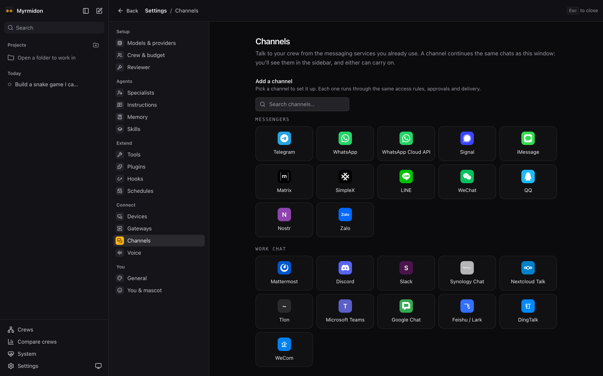

<div align="center">



Myrmidon is a local-first, open-source agent harness. You talk to one lead; it answers, codes, browses, or brings
in a crew of specialists when the job is big. Use it in the browser or the macOS app, from 30 messaging channels,
or by voice and phone call.
Every step is logged, sandboxed, and reviewable.

[](LICENSE)
[](https://bun.sh)
[](tsconfig.json)
[](#status)

[Quick start](#quick-start) · [How it works](#how-it-works) · [Features](#features) · [Architecture](#architecture) ·
[Roadmap](ROADMAP.md) · [Contributing](#contributing)

<br>

<picture>
  <source media="(prefers-color-scheme: light)" srcset="docs/assets/home-light.png">
  
</picture>

</div>

---

## Why Myrmidon

Most agent tools make you pick a shape up front: a chat bot, a coding agent, a browser operator, or a multi-agent
framework you wire together yourself. Myrmidon is all four behind a single conversation.

- **The work sizes itself.** A quick question gets a plain reply. A script gets written by the lead alone. A
  multi-part build or research job escalates to a crew, orchestrated by a lead or run as a leaderless swarm.
- **It is the harness, not a wrapper.** Myrmidon runs its own agent loop, tools, sandbox, and model calls. No other
  CLI has to be installed or logged in.
- **Any model, per agent.** Anthropic, OpenAI, Codex, Gemini, OpenRouter, Ollama, or any OpenAI-compatible endpoint.
  The lead, each worker, and the reviewer can each run a different model.
- **Nothing is hidden.** Every message, tool call, file, and decision is an event in an append-only SQLite log that
  refuses `UPDATE` and `DELETE`. The UI, replay, audit view, and exports all read that same log.
- **Talk to it from anywhere.** Telegram, WhatsApp, Signal, iMessage, Slack, Discord, Teams, email and more continue
  the same chats as the browser. Call your crew from the app or a phone; run it on a server and pair your devices.
- **Extend it without forking it.** Plugins use Claude Code's folder format (skills, commands, hooks, MCP servers)
  plus Myrmidon code and UI. Ask the lead for a Myrmidon feature and it builds one as a plugin.
- **Safe by default.** Shell commands run under `sandbox-exec` (macOS) or bubblewrap (Linux). Secrets are redacted
  from logs and transcripts. Fetched web pages are treated as untrusted data. Each tool can be set to Allow, Ask
  first, or Off.
- **Done means checked.** An independent reviewer (off, auto, or always) can run real tests, rules, and an LLM
  rubric against the output. Agents cannot mark their own work verified.
- **Yours.** Runs on your machine, stores data in `~/.myrmidon`, Apache-2.0.

## Quick start

You need [Bun](https://bun.sh) 1.3.14 or newer and access to at least one model provider: an API key in the usual
environment variable (for example `ANTHROPIC_API_KEY` or `OPENAI_API_KEY`), a key or endpoint added in
**Settings → Models & providers**, or a ChatGPT/Codex sign-in.

```bash
git clone https://github.com/Robinbinu/myrmidon.git
```

```bash
cd myrmidon && bun install
```

```bash
bun run myr serve
```

The command prints a `http://127.0.0.1:…/#token=…` link. Open it and a setup assistant walks you through nine
skippable steps (models, crew, a first project, voice, messaging apps, alerts), detecting the providers you already
have. Then type what you want done.



On a Mac you can run it as a desktop app instead. The app starts its own server and has native menus, a dock badge,
and a folder picker:

```bash
bun run desktop
```

`bun run desktop:build` packages it with Electrobun.

Prefer the terminal? `bun run myr setup` walks through sign-in or keys, the default model and a first device, and
`bun run myr doctor` checks the server, models, sandbox, browser tools, previews, devices and channels.

Already use [oh-my-pi](https://github.com/can1357/oh-my-pi)? Bring your keys, sign-ins, and `models.yml` across:

```bash
bun run myr import-omp
```

## How it works



1. **The lead starts at once.** Every request goes straight to one lead with every tool. It answers directly, does
   moderate work itself, asks a crewmate for one piece of work (`ask_crewmate`), or calls `escalate(to: team)` early
   when parallel specialists would help.
2. **Crews coordinate through logged tools only:** a shared board with `@mentions`, direct mail, append-only notes,
   a task graph with revision checks, and versioned artifacts. Nothing is edited in place.
3. **Two crew modes.**

   | Mode | Shape | Best for |
   |---|---|---|
   | Orchestrated | A lead plans and assigns; specialist workers (researcher, coder, writer…) each on their own model | Builds with a clear split of parts |
   | Swarm | Equal peers huddle, merge a plan, claim tasks; the most productive peer speaks | Exploratory work, research, A/B of coordination |

4. **Finishing follows your reviewer setting.** Off: the answer ends the round. Auto: the lead asks for a review
   when the work deserves one. Always: every final answer is checked and findings go back as fix tasks.
5. **Follow-ups carry on.** Files, notes, and each agent's own conversation persist across rounds of a chat. Write
   `@name` to talk to one crewmate directly, or open one-to-one chats, groups and a team chat with the crew.

The agent-facing docs in [`packages/runtime/docs`](packages/runtime/docs) describe the same rules the agents read at
runtime.

### See a crew at work

A lead plans a snake game, a coder and a tester build it in parallel, and the reviewer scores the result.



<table>
  <tr>
    <td width="50%"></td>
    <td width="50%"></td>
  </tr>
  <tr>
    <td align="center"><sub><b>Crew console</b>: every tool call, task and verdict, with replay</sub></td>
    <td align="center"><sub><b>Artifacts</b>: published files open in a sandboxed preview</sub></td>
  </tr>
</table>

<sub>Screens from a demo run with scripted models, so the steps are reproducible.</sub>

### Reach your crew from anywhere



## Features

### Coding harness

- Work in a real project folder, with `AGENTS.md` / `CLAUDE.md` / `.myrmidon.md` read at kickoff.
- `grep`, `glob`, `run_checks`, a project outline, and fs read/write/edit confined to the project.
- **Checkpoints and rewind** before a round's first write; per-round diffs and a Git view to stage and commit (it
  never pushes).
- **A git worktree per coding worker**, so parallel agents never share a working tree.
- Dev servers the agents can start, open in their browser, and show you live.
- Per-project permissions: autonomous, ask, or read-only; a new folder starts on ask.
- Context compaction that respects each model's real context window.

### Browser agent

- A real Chrome over CDP: aria snapshots with refs, click, type, tabs, uploads, downloads, console, network.
- `browser_extract(schema)` turns a page into JSON instead of a long snapshot.
- **Login handoff:** the agent asks, you sign in through the live view, it carries on. Agents never type passwords.
- Live view with the agent's cursor; take over at any time; saved browser flows replay as tools.

### Crews

- Orchestrated and swarm modes, persistent workers across rounds, random call signs (`nova`, `kai`, …).
- Mid-round escalation, task rejection with reasons, non-blocking check-ins, and `ask_user` pauses.
- A live task board, a crew map, and a run comparison view with diffs.
- Review tailored to the kind of work: tests for code, citation checks for research, a rubric for writing.

### Channels, voice and devices

- **30 channels** built in: Telegram, WhatsApp (linked device or Cloud API), Signal, iMessage, Matrix,
  Slack, Discord, Mattermost, Microsoft Teams, Google Chat, LINE, WeChat, WeCom, Feishu/Lark, DingTalk, QQ, email,
  SMS, ntfy, IRC, Twitch, X, Nostr, SimpleX, Zalo, Synology Chat, Nextcloud Talk, Tlon and a generic webhook. A
  channel continues the same chats as the browser.
- **Approved people only.** A new sender gets a code and nothing else until you approve it; the first person
  approved is the owner, later ones are members, and members' runs ask the owner before each outside step.
- **Voice and phone calls.** Press Call and talk, or ring your Twilio number from any phone: a fast call model
  answers out loud and hands real work to the crew while the call goes on. Silero VAD and Smart Turn detect your
  turns; speech runs on local engines (Phonon-2, Kitten TTS) or a cloud or OpenAI-compatible provider. Approvals
  count only on a plain spoken yes or no.
- **Run it on a server.** Turn any VPS or home server into a gateway, reach it over Tailscale or an SSH tunnel,
  pair each device once (full access or chats only), and revoke it any time. One window can switch between
  several gateways. See [docs/remote.md](docs/remote.md).

### The app

- **Setup assistant** on first run, resumable, with **Run setup again** in Settings.
- **macOS desktop app** on Electrobun; its server stops with the app, and no agent process outlives Myrmidon.
- A **⌘K command menu**, a ⌘/ shortcuts sheet, context menus everywhere, and Settings laid out like System Settings.
- **Search** across every chat's messages (SQLite FTS5).
- The project folder as a file tree, with the files agents edit shown and opened.
- Safe defaults: new project folders ask before changing files, each run stops at $5 unless you raise it, and the
  cheapest model you have names your chats.

### Agent harness

- **MCP servers** with a circuit breaker for flaky ones.
- **Plugins** in Claude Code's folder format, plus Myrmidon plugin code that adds tools, prompts, listeners, chat
  cards, tabs and Settings pages.
- **Skills** in the Agent Skills format, from Myrmidon's folder, `~/.claude/skills`, or the project. **Learn a skill**
  from how a round was done; a curator retires learned skills nobody uses.
- **Specialists** you keep and bring back to later chats.
- **Hooks** in Claude Code's format, before and after tools and at round end.
- **Self-made tools:** agents write sandboxed tools with an input schema; keep the good ones in a library.
- **Memory** across chats: agents propose, you decide what is kept.
- **Background and scheduled rounds** from the CLI or cron schedules, with desktop notifications.
- **Budgets** for wall time, turns, tokens, and dollars, with live spend in the run card.
- **Audit view** of every file, URL, and command each agent touched, and what was stopped.

## Scripted crews

For repeatable runs and research, describe a crew in YAML and run it headless or with the UI:

```yaml
name: Calculator
mission: ./task.md            # inline text or a .md file
pattern: lead-workers         # or blackboard (swarm)
agents:
  - { name: lead, role: lead, model: anthropic/claude-sonnet-4-5 }
  - { name: coder, role: worker, model: openai/gpt-5, count: 2 }
acceptance:
  - { verifier: checks, rules: [{ artifact: index.html, contains: "<html" }] }
  - { verifier: command, run: "bun test", against: [src/, tests/] }
  - { verifier: llm-judge, model: openai/gpt-5, rubric: ./rubric.md, threshold: 0.8 }
budget: { wall: 15m, costUsd: 5, maxTurns: 40 }
observer: { interval: 30s }
```

```bash
bun run myr run examples/calculator/colony.yaml --ui
```

The [calculator example](examples/calculator) has three agents build a calculator while the verifier runs real
tests against their code. Edit its `model:` lines to models you have access to.

## CLI

| Command | What it does |
|---|---|
| `myr serve [--port N] [--host ADDR] [--public-url URL]` | Start the server and web UI; a host or public URL makes it a remote gateway |
| `myr setup` | Sign-in or keys, the default model and a first device, in the terminal |
| `myr login [ID]` · `myr key [PROVIDER]` · `myr model [REF]` | Sign in with a subscription, add an API key, or set the default model |
| `myr pair [--scope full\|chat]` | Print a single-use link that pairs a device |
| `myr channels …` | Set up a messaging channel and approve or revoke people |
| `myr doctor` | Check the server, models, sandbox, browser tools, previews, devices and channels |
| `myr run <spec.yaml> [--ui]` | Run a scripted crew |
| `myr ask "<request>" [--chat ID] [--project ID] [--wait]` | Send a request to a running server; `--wait` prints the final answer |
| `myr ls` | List crews |
| `myr events <id> [--json]` | Print a crew's event log |
| `myr export <id> [--out run.jsonl]` | Export a crew's events as JSONL |
| `myr import-omp` | Copy an oh-my-pi setup from `~/.omp` |

Run them with `bun run myr …`. Data lives in `~/.myrmidon`; override with `--home DIR` or `MYRMIDON_HOME`.

## Architecture

A Bun + TypeScript monorepo. The HTTP/WebSocket API and the event protocol are the contract, so native clients can
follow the browser UI without the runtime changing.

| Package | Role |
|---|---|
| [`packages/protocol`](packages/protocol) | Event and payload types, crew state projection; shared by server and clients |
| [`packages/core`](packages/core) | Append-only event log as a [Cordis](https://www.npmjs.com/package/@deepseek-ai/cordis) service, SQLite store, validation, redaction, guards, blobs |
| [`packages/runtime`](packages/runtime) | Agents, tools, team patterns, observer, reviewer, sandbox, browser, MCP, skills, hooks, plugins, channels, voice, worktrees, recovery |
| [`apps/web`](apps/web) | API server (local or remote gateway with paired devices) and the React UI |
| [`apps/cli`](apps/cli) | The `myrmidon` command |
| [`apps/desktop`](apps/desktop) | The macOS app (Electrobun) that runs the server as a sidecar |
| [`apps/eval`](apps/eval) | Eval harness with fixed coding, browsing, research, and crew cases |

Models and the agent loop come from [`@oh-my-pi/pi-ai`](https://github.com/can1357/oh-my-pi) and
`@oh-my-pi/pi-agent-core`, embedded in-process behind Myrmidon's own interfaces. Design notes live in
[`docs/superpowers/specs`](docs/superpowers/specs); guides for [channels](docs/channels.md),
[voice calls](docs/voice.md) and [remote gateways](docs/remote.md) live in [`docs`](docs).

## Development

```bash
bun run dev
```

Serves the UI on http://127.0.0.1:4318 with hot reload. The server restarts when server or runtime code changes, and
the browser's console output prints in the same terminal. It needs no access token; stop anything else on port 4318
first.

```bash
bun run check
```

Runs the type checker, Biome, and the test suite, including an end-to-end crew driven by scripted models.

```bash
bun run eval
```

Runs the eval suite against real models and writes a JSON report you can diff between changes.

## Status

Myrmidon is alpha. It works end to end, but APIs, the event schema, and storage formats will
still change. The clients today are the browser UI and a macOS app; other desktop platforms come later. See the
[roadmap](ROADMAP.md) for
what is done and what is next.

## Contributing

Issues and pull requests are welcome.

1. Run `bun run check` before opening a pull request; it must pass.
2. Keep changes focused, and match the surrounding code's style.
3. Write commit subjects in plain, imperative English that say why.

Good places to start: the open items in [ROADMAP.md](ROADMAP.md) (benchmarks in Milestone 4), new eval cases in
[`apps/eval`](apps/eval), and the agent docs in [`packages/runtime/docs`](packages/runtime/docs).

## Acknowledgements

Built on [oh-my-pi](https://github.com/can1357/oh-my-pi) for models and the agent loop, and
[Cordis](https://www.npmjs.com/package/@deepseek-ai/cordis) for the plugin and service system. Channels are ported
from [Hermes Agent](https://github.com/NousResearch/hermes-agent) and [OpenClaw](https://github.com/openclaw/openclaw)
(both MIT); voice turn-taking uses [Silero VAD](https://github.com/snakers4/silero-vad) and Pipecat's
[Smart Turn](https://github.com/pipecat-ai/smart-turn). Inspired by Claude
Code, Codex, Cursor, and Manus.

## License

[Apache License 2.0](LICENSE)
