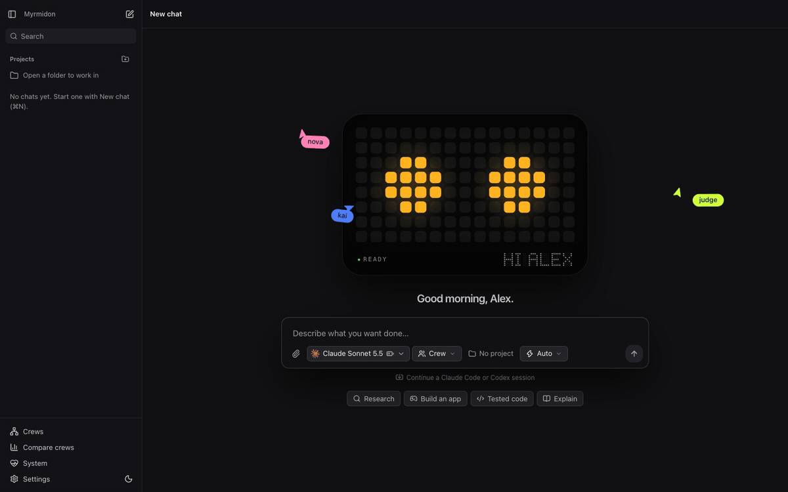
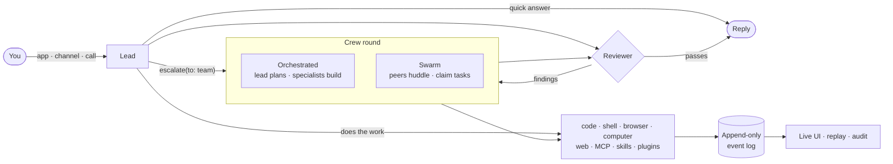
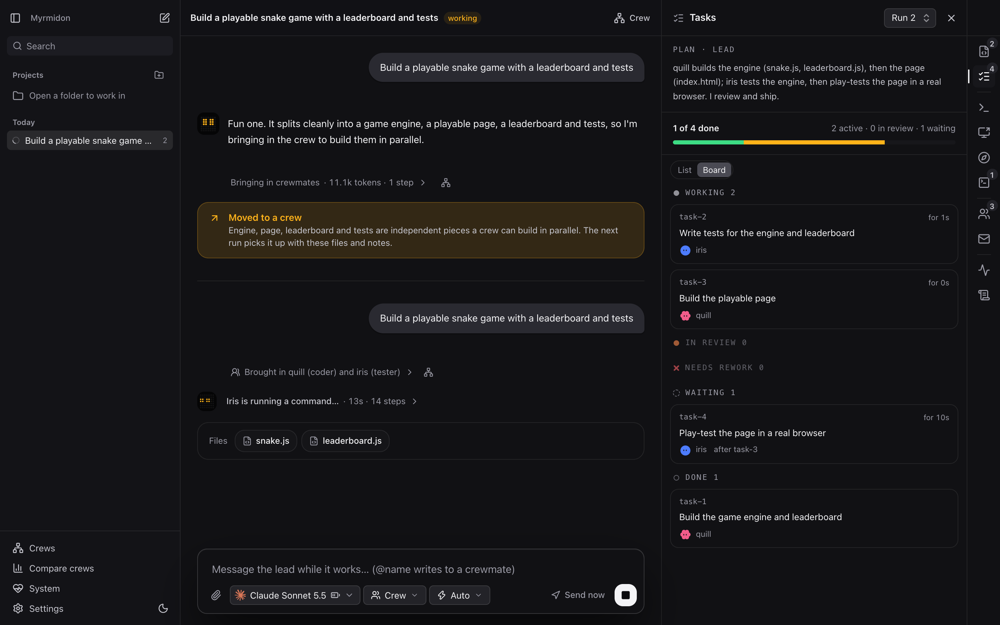
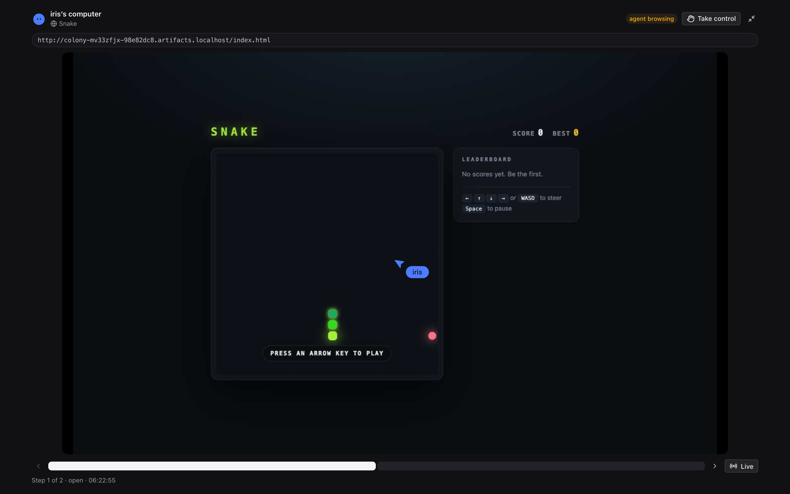
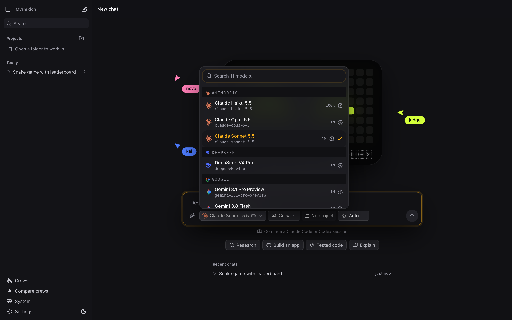
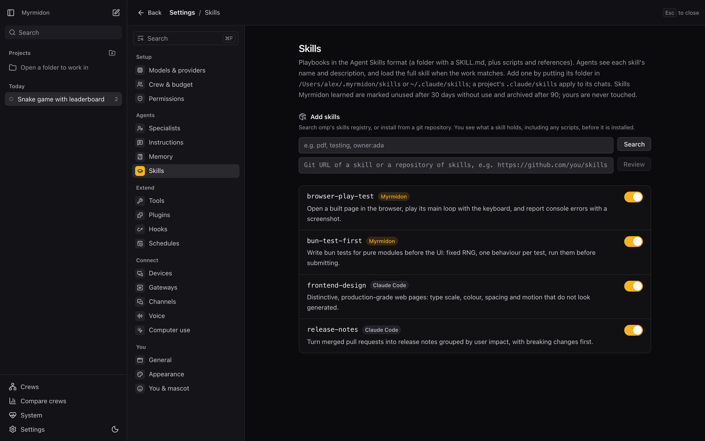
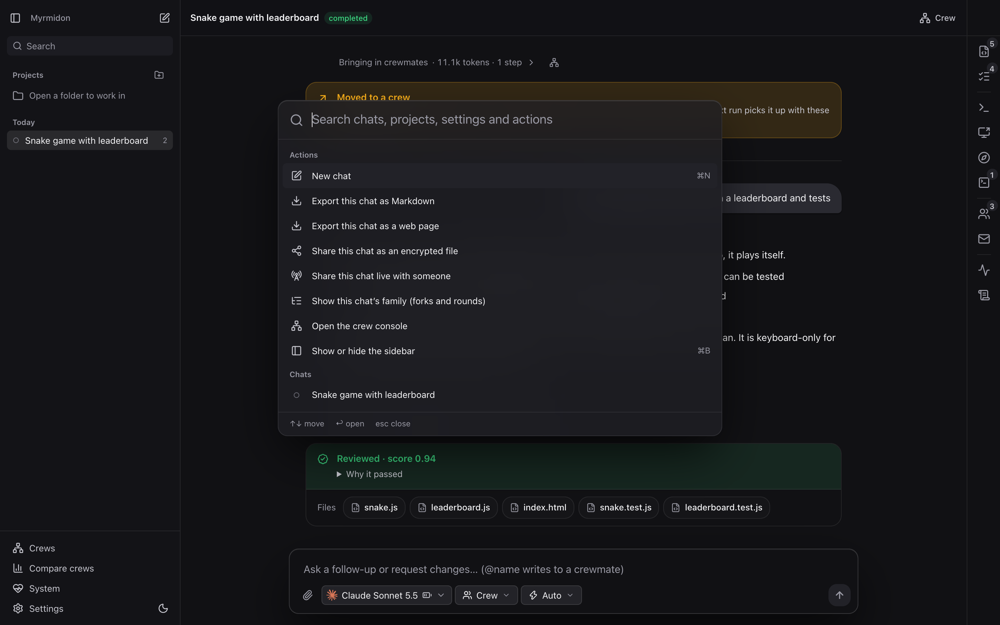

<div align="center">


### One chat. A whole crew of AI agents. Running on your Mac.

Myrmidon is an open-source, local-first AI agent platform. Ask for anything: it answers, writes code, drives a
browser, uses your Mac's apps, or brings in a crew of specialists that plan, build and check each other's work.
Reach it from the app, from 30 messaging apps, or by phone call. Use the AI subscriptions you already pay for.

[](LICENSE)
[](#status)
[](https://bun.sh)
[](tsconfig.json)
[](#status)

[Quick start](#quick-start) · [What it does](#one-app-instead-of-ten) · [How it works](#how-it-works) ·
[Features](#features) · [Contributing](#contributing) · [Roadmap](ROADMAP.md)

<br>



<sub>23 seconds, real UI, scripted models: one request becomes a crew that builds, tests and reviews a game.
<a href="docs/assets/demo.mp4">Watch the MP4</a>.</sub>

</div>

---

## One app instead of ten

Most AI tools make you pick one shape: a chat bot, a coding agent, a browser operator, a computer-use agent, a
multi-agent framework, a messaging bot. Myrmidon is all of them behind one conversation, sharing one memory, one
permission model and one audit log.

| Myrmidon does | The tools it can stand in for |
|---|---|
| Coding agent with checkpoints, a git worktree per worker, LSP, AST search and rewrite, a debugger and code cells | Claude Code, Codex CLI, Cline, Aider |
| Parallel agents on one repo, diffs per round, run comparison | Conductor, Codex app |
| Browser agent in a real Chrome, with login handoff and saved flows | Manus, Operator, Browser Use |
| Computer use on your Mac, with a glow and agent cursors while it works | Claude computer use, OpenAI CUA |
| Crews: lead and workers, or a leaderless swarm, with a reviewer and an advisor | CrewAI, AutoGen, LangGraph, Devin |
| 30 messaging channels: Telegram, WhatsApp, Signal, iMessage, Slack, Discord, Teams… | OpenClaw, Hermes Agent |
| Voice and phone calls that hand real work to the crew | ChatGPT Voice, Vapi |
| Every major model, by API key or by signing in with your subscription | OpenRouter, LiteLLM |
| Memory you approve, skills it learns, plugins in Claude Code's format | ChatGPT Memory, Claude Code plugins |

It is a harness, not a wrapper: Myrmidon runs its own agent loop, tools, sandbox and model calls. No other CLI has
to be installed or signed in.

<picture>
  <source media="(prefers-color-scheme: light)" srcset="docs/assets/home-light.png">
  
</picture>

## Quick start

You need macOS, [Bun](https://bun.sh) 1.3.14 or newer, and one way to reach a model: sign in with Claude, ChatGPT,
Gemini or GitHub Copilot, or use an API key (`ANTHROPIC_API_KEY`, `OPENAI_API_KEY`, …).

```bash
git clone https://github.com/Robinbinu/myrmidon.git
```

```bash
cd myrmidon && bun install
```

```bash
bun run desktop
```

The desktop app starts its own server and opens a setup assistant: models, crew, a first project, voice, messaging
apps and alerts, every step skippable. It finds the providers you already have. Then type what you want done.


Prefer a browser tab? `bun run myr serve` prints a `http://127.0.0.1:…/#token=…` link. Prefer the terminal?
`bun run myr setup` signs you in and picks a model, and `bun run myr doctor` checks everything.

Coming from another tool? Bring your history and setup along:

```bash
bun run myr import-session   # Claude Code and Codex chats
```

```bash
bun run myr import-omp       # oh-my-pi keys, sign-ins and models.yml
```

## How it works



1. **The work sizes itself.** Every request goes to one lead with every tool. A question gets an answer, a script
   gets written by the lead alone, and a multi-part job escalates to a crew.
2. **Crews coordinate in the open:** a shared board with `@mentions`, direct messages, append-only notes, a task
   graph and versioned artifacts. Nothing is edited in place.
3. **Two crew modes.** *Orchestrated*: a lead plans and assigns specialists, each on its own model. *Swarm*: equal
   peers huddle, merge a plan and claim tasks.
4. **Done means checked.** An independent reviewer runs real tests, rules and a rubric; agents cannot mark their own
   work verified. An advisor watches the steps and steers when it sees a concrete problem.
5. **Nothing is hidden.** Every message, tool call, file and decision is an event in an append-only SQLite log that
   refuses `UPDATE` and `DELETE`. The UI, replay, audit view and exports all read it.

### See a crew at work

A lead plans a snake game, a coder and a tester build it in parallel, and the reviewer scores the result.


<table>
  <tr>
    <td width="50%"></td>
    <td width="50%"></td>
  </tr>
  <tr>
    <td align="center"><sub><b>Crew console</b>: every tool call, task and verdict, with replay</sub></td>
    <td align="center"><sub><b>Artifacts</b>: published files open in a sandboxed preview</sub></td>
  </tr>
</table>

<table>
  <tr>
    <td width="50%"></td>
    <td width="50%"></td>
  </tr>
  <tr>
    <td align="center"><sub><b>Task board</b>: who is on what, live</sub></td>
    <td align="center"><sub><b>Browser agent</b>: watch it work, take over any time</sub></td>
  </tr>
</table>

<sub>Every screen comes from a demo run with scripted models in a throwaway data folder
(<code>bun scripts/readme-screens.ts</code>), so it is reproducible and holds no personal data.</sub>

## Features

### Code

- Works in your project folder and reads `AGENTS.md`, `CLAUDE.md` and `.myrmidon.md` at kickoff.
- File, `grep`, `glob` and `find` tools; `ast_grep` and `ast_edit` for structural search and rewrite; `lsp` for
  definitions, references and diagnostics; `debug` with any DAP adapter (debugpy, js-debug, lldb, gdb); `eval` code
  cells in JavaScript and Python whose state lasts the round.
- **Checkpoints and rewind** before a round's first write, diffs per round, and a Git view to stage and commit (it
  never pushes).
- **A git worktree per coding worker**, so parallel agents never share a working tree.
- Dev servers agents start and you watch live; an integrated terminal with several shells.
- A `github` tool for issues, pull requests, diffs, checks and Actions runs; writes always ask you first.
- `security_scan` for leaked secrets and vulnerable dependencies; `autoresearch` keeps a change only if a measured
  metric improves.
- `/goal` keeps going until a command, the checks or a judge says the goal holds.

### Browser and computer

- A real Chrome over CDP: snapshots, click, type, tabs, uploads, downloads, console, network, and
  `browser_extract(schema)` to turn a page into JSON.
- **Login handoff:** the agent asks, you sign in through the live view, it carries on. Agents never type passwords.
- Take over any time; saved browser flows replay as tools; your own tabbed browser beside the chat.
- **Computer use on macOS** through [Cua Driver](https://github.com/trycua/cua): one approved app at a time,
  consequential steps asked first, a glow round the screen and each agent's cursor while it works. Esc stops it.

### Crews

- Orchestrated and swarm modes, persistent workers across rounds, and specialists you keep for later chats.
- Mid-round escalation, task rejection with reasons, check-ins and `ask_user` pauses.
- A live task board, crew map, replay and run comparison with diffs.
- Review fitted to the work: tests for code, citations for research, a rubric for writing.
- Scripted crews in YAML for repeatable runs, with acceptance verifiers and budgets (see below).

### Models

- Anthropic, OpenAI, Codex, Gemini, OpenRouter, Ollama, xAI and any OpenAI-compatible endpoint, through
  [oh-my-pi](https://github.com/can1357/oh-my-pi).
- **Sign in with the subscriptions you already have**: Claude, ChatGPT, Gemini, GitHub Copilot and more. Plan limits
  show how much of each window is left, as a battery on the model chip.
- A different model per agent, fallback models when one fails, and compaction that respects each model's real
  context window.
- `generate_image` and `tts` for pictures and speech as chat artifacts.



### Channels, voice and devices

- **30 channels**: Telegram, WhatsApp (linked device or Cloud API), Signal, iMessage, Matrix, Slack, Discord,
  Mattermost, Microsoft Teams, Google Chat, LINE, WeChat, WeCom, Feishu/Lark, DingTalk, QQ, email, SMS, ntfy, IRC,
  Twitch, X, Nostr, SimpleX, Zalo, Synology Chat, Nextcloud Talk, Tlon and a generic webhook. They continue the same
  chats as the app.
- **Approved people only.** A new sender gets a code and nothing else until you approve them; members always run
  sandboxed and ask the owner before outside steps.
- **Voice and phone calls.** Press Call, or ring your Twilio number: a fast call model talks while the crew works.
  Speech runs locally (Phonon-2, Kitten TTS) or on Deepgram, ElevenLabs, Cartesia, OpenAI, Google, Azure, AWS and
  more, or the call runs on OpenAI Realtime or Gemini Live.
- **Run it on a server** and pair your devices over Tailscale or SSH. See [docs/remote.md](docs/remote.md).


### Extend it

- **MCP servers** over stdio, HTTP or SSE, with OAuth and a circuit breaker for flaky ones.
- **Plugins** in Claude Code's format, from Claude Code marketplaces, git or npm, reviewed before anything runs.
  Myrmidon plugins can add tools, prompts, chat cards, tabs and Settings pages. Ask the lead for a feature and it
  builds one as a plugin.
- **Skills** in the Agent Skills format, from your folders, `~/.claude/skills`, projects or a registry. Myrmidon
  learns new skills from finished rounds and retires the ones nobody uses.
- **A skill scanner** checks every skill before agents get it: prompt injection, data exfiltration, credential
  access, obfuscated code, pipe-to-shell installs, login persistence and hidden Unicode. A skill with a critical
  finding is held until you allow it.
- **Hooks** in Claude Code's format, **stream rules** that stop a reply mid-stream when it breaks a rule, and
  self-made tools kept in a library.
- **Memory** across chats: a cheap model suggests what to remember, you decide what is kept.



### Safe by default

- Commands run in macOS's sandbox: agents read the project and toolchains, write only the project and their work
  files, and cannot see the rest of your home, other chats or your keys.
- Secrets are redacted from logs and reach model providers as placeholders.
- Every tool can be Allow, Ask first or Off; projects start on ask; each run stops at $5 unless you raise it.
- An audit view of every file, URL and command each agent touched. Want it unrestricted, like Hermes Agent? Turn on
  **full access** for a project; approvals still apply.

### The app

- A desktop app with native menus, notifications and a Dock badge, or any browser.
- ⌘K command menu, search across every chat, chat groups and forks, a file tree of your project.
- Export a chat as Markdown or a standalone HTML page, share it live with guests, or send an encrypted share file.
- Scheduled rounds, background runs (`myr ask --wait`) and OpenTelemetry export.



## Scripted crews

Describe a crew in YAML and run it headless or with the UI:

```yaml
name: Calculator
mission: ./task.md            # inline text or a .md file
pattern: lead-workers         # or blackboard (swarm)
agents:
  - { name: lead, role: lead, model: anthropic/claude-sonnet-4-5 }
  - { name: coder, role: worker, model: openai/gpt-5, count: 2 }
acceptance:
  - { verifier: checks, rules: [{ artifact: index.html, contains: "<html" }] }
  - { verifier: command, run: "bun test", against: [src/, tests/] }
  - { verifier: llm-judge, model: openai/gpt-5, rubric: ./rubric.md, threshold: 0.8 }
budget: { wall: 15m, costUsd: 5, maxTurns: 40 }
observer: { interval: 30s }
```

```bash
bun run myr run examples/calculator/colony.yaml --ui
```

## CLI

| Command | What it does |
|---|---|
| `myr serve [--port N] [--host ADDR] [--public-url URL]` | Start the server and web UI; a host or public URL makes it a remote gateway |
| `myr setup` · `myr doctor` | Set up in the terminal; check models, sandbox, browser, devices and channels |
| `myr login [ID]` · `myr key [PROVIDER]` · `myr model [REF]` | Sign in with a subscription, add an API key, or set the default model |
| `myr ask "<request>" [--wait]` | Send a request to a running server |
| `myr run <spec.yaml> [--ui]` | Run a scripted crew |
| `myr plugins …` · `myr skills …` | Search, add, update, remove and scan plugins and skills |
| `myr channels …` · `myr pair` | Set up messaging channels and pair devices |
| `myr import-session` · `myr import-omp` | Bring in Claude Code and Codex chats, or an oh-my-pi setup |
| `myr ls` · `myr events <id>` · `myr export <id>` | List crews and read or export their event logs |

Run them with `bun run myr …`. Data lives in `~/.myrmidon`; override with `--home DIR` or `MYRMIDON_HOME`.

## Architecture

A Bun + TypeScript monorepo. The HTTP/WebSocket API and the event protocol are the contract, so new clients can
follow the app without the runtime changing.

| Package | Role |
|---|---|
| [`packages/protocol`](packages/protocol) | Event and payload types, crew state projection |
| [`packages/core`](packages/core) | Append-only event log, SQLite store, validation, redaction, guards, blobs |
| [`packages/runtime`](packages/runtime) | Agents, tools, crews, reviewer, sandbox, browser, computer use, MCP, skills, plugins, channels, voice |
| [`apps/web`](apps/web) | API server (local or remote gateway) and the React UI |
| [`apps/desktop`](apps/desktop) | The desktop app (Electrobun), running the server as a sidecar |
| [`apps/cli`](apps/cli) | The `myr` command |
| [`apps/eval`](apps/eval) | Eval harness with coding, browsing, research and crew cases |

## Status

Myrmidon is **alpha** and built for **macOS first**. It works end to end and is used every day, but APIs, the
event schema and storage formats will still change. Linux and Windows are next: the code is portable, and what is
left is tracked in [#27](https://github.com/Robinbinu/myrmidon/issues/27) (Linux) and
[#28](https://github.com/Robinbinu/myrmidon/issues/28) (Windows). See the [roadmap](ROADMAP.md) for what is done
and what is next.

## Contributing

Myrmidon is big, and there is room for you in it. Good first places:

- **Linux and Windows support**: issues labeled [`linux`](https://github.com/Robinbinu/myrmidon/labels/linux) and
  [`windows`](https://github.com/Robinbinu/myrmidon/labels/windows).
- **Channels**: every channel is tested against fakes; trying one against the real service and fixing what breaks
  is a great first pull request.
- **Eval cases** in [`apps/eval`](apps/eval), and the agent docs in [`packages/runtime/docs`](packages/runtime/docs).

Before a pull request, run `bun run check` (types, lint and the full suite); keep changes focused and match the
surrounding style. Development server with hot reload: `bun run dev`.

If Myrmidon is useful to you, **star the repo**: it is the simplest way to help more people find it.

## Acknowledgements

Built on [oh-my-pi](https://github.com/can1357/oh-my-pi) for models and the agent loop,
[Cordis](https://www.npmjs.com/package/@deepseek-ai/cordis) for services, and
[Electrobun](https://electrobun.dev) for the desktop app. Computer use runs on
[Cua Driver](https://github.com/trycua/cua). Channels are ported from
[Hermes Agent](https://github.com/NousResearch/hermes-agent) and [OpenClaw](https://github.com/openclaw/openclaw);
voice turn-taking uses [Silero VAD](https://github.com/snakers4/silero-vad) and Pipecat's
[Smart Turn](https://github.com/pipecat-ai/smart-turn); the composer's next-word model is EleutherAI's
[Pythia-14M](https://huggingface.co/EleutherAI/pythia-14m). Inspired by Claude Code, Codex, Cursor and Manus. Full
notices are in [THIRD_PARTY_NOTICES.md](THIRD_PARTY_NOTICES.md).

## Author

Myrmidon is created and maintained by [@Robinbinu](https://github.com/Robinbinu). Building
something with it, want to collaborate, or hiring for agent work? Say hello on
[LinkedIn](https://www.linkedin.com/in/michaelrobink).

## License

[Apache License 2.0](LICENSE). See [NOTICE](NOTICE) for attribution.
